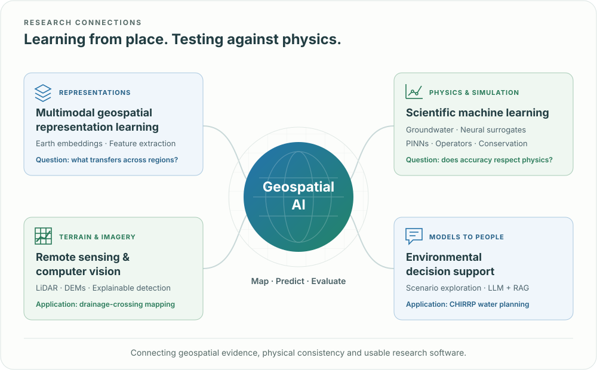

<h1 align="center">Hi there 👋, I'm Michael Edidem</h1>

<strong>Geospatial AI · Scientific machine learning · Environmental systems</strong> PhD Researcher @ Southern Illinois University Carbondale · Expected graduation <strong>2027</strong>

[🌍 Portfolio](https://mikedidem.github.io/medidem/) · [📄 CV](https://mikedidem.github.io/medidem/cv/Michael_Edidem_CV.pdf) · [📚 Publications](https://mikedidem.github.io/medidem/publications/) · [📫 Email](mailto:edidemichael@gmail.com)

## 🌟 About me

**If we could observe every place on Earth, every day, what could we learn about how our planet changes—and how it shapes us?**

I develop geospatial AI and scientific machine-learning methods to turn imagery, terrain and simulation data into useful knowledge about infrastructure and environmental systems. My research explores how we can learn from sparse, heterogeneous observations and build predictions we can trust.

With a background in geomatics, I bring a spatial perspective to machine learning, connecting terrain, remote sensing and environmental modeling in my research.

- 🔭 Currently exploring **multimodal geospatial representation learning** and **neural surrogates**, with a focus on geospatial foundation (GF) models, multimodal feature extraction and learning from sparse, heterogeneous geospatial data.
- 💬 Ask me about **LiDAR/DEM analysis, drainage crossings, groundwater surrogates**, or making models easier to evaluate.
- 📚 M.S., Geography & Environmental Resources (Geospatial AI), SIUC, **2024** · B.S., Geoinformatics & Surveying, University of Uyo, **2019**.

✨ **My guiding idea:** “Learning from Earth’s complexity to build models we can trust and knowledge we can act on.”

---

<!-- 🌐 Research Framework -->

  

## 🐍 Contribution Activity

  <picture>
    <source media="(prefers-color-scheme: dark)"
            srcset="https://raw.githubusercontent.com/mikedidem/mikedidem/output/github-contribution-grid-snake-dark.svg" />
    
  </picture>

---

## 📝 Selected projects

### 💧 Groundwater surrogates: accuracy and conservation

[**gw_surrogate_evaluation**](https://github.com/mikedidem/gw_surrogate_evaluation) · Lead author & developer · Manuscript under review

A surrogate can reproduce hydraulic head at **R² > 0.999** and still fail to conserve water. I built a diagnostic framework comparing CNN, ConvLSTM and PINN surrogates against MODFLOW-2005 on two synthetic aquifers, measuring predictive error, governing-equation residuals, boundary behavior and mass balance together.

The repository includes reproducible evaluators, benchmark configurations and tests. [Case study](https://mikedidem.github.io/medidem/projects/groundwater-surrogates/)

### 🌊 CHIRRP: groundwater scenarios in plain language

[**chirrp**](https://github.com/mikedidem/chirrp) · Co-author & repository maintainer · Manuscript under review

A deployed research application connecting natural-language scenario requests to a physics-informed groundwater surrogate, with regulation retrieval and an on-demand MODFLOW cross-check. Its CPU surrogate evaluation is approximately **238× faster than MODFLOW** in the reported benchmark; this is distinct from end-to-end interaction time.

**PyTorch · FastAPI · Angular · Docker · RAG** 
[Live demo](https://morule-hydro.hf.space) · [Case study](https://mikedidem.github.io/medidem/projects/chirrp/)

### 🛰️ Drainage crossings: finding what terrain hides

[**Detection code**](https://github.com/GeoFewLab/Drainage_CrossingDet) · [**Classification code**](https://github.com/GeoFewLab/Drainge_CrossingClassification) · First author of two 2025 papers

Culverts and bridges are often missing from elevation-derived stream networks. My research uses high-resolution LiDAR DEMs and terrain derivatives to classify and locate drainage crossings, with Grad-CAM to examine the features driving predictions. The best classification configuration reached **97.9% accuracy within the study watershed**; geographic transfer is a separate research question.

[Detection paper](https://doi.org/10.1016/j.envsoft.2025.106338) · [Classification paper](https://doi.org/10.3389/frai.2025.1561281) · [Case study](https://mikedidem.github.io/medidem/projects/drainage-crossing-detection/)

### 🌱 Soil Swin-UNet

[**soil**](https://github.com/mikedidem/soil) · Earlier work within GeoFewLab

Swin-UNet experiments for drought forecasting across remote-sensing drought indices—part of my broader work with Earth-observation data and spatial deep learning.

---

## 📚 Publications

- **Edidem, M.**, Xu, B., Li, R., Wu, D., Rekabdar, B., Wang, G. (2025). *[Identification of Drainage Crossings on High-Resolution Digital Elevation Models Using Explanatory Deep Learning Approaches](https://doi.org/10.3389/frai.2025.1561281)*. **Frontiers in Artificial Intelligence**
- **Edidem, M.**, Li, R., Wu, D., Rekabdar, B., Wang, G. (2025). *[GeoAI-based Drainage Crossing Detection for Elevation-derived Hydrographic Mapping](https://doi.org/10.1016/j.envsoft.2025.106338)*. **Environmental Modelling & Software**
- Nazeri, A., Godwin, D.W., Panteleaki, A.M., Anagnostopoulos, I., **Edidem, M.**, Li, R., Shu, T. (2025). *[Exploration of TPU Architectures for the Optimized Transformer in Drainage Crossing Detection](https://doi.org/10.1109/BigData62323.2024.10826077)*. Proceedings of 2024 IEEE International Conference on Big Data
- Wu, D., Li, R., **Edidem, M.**, Wang, G. (2024). *[Enhancing Hydrologic LiDAR Digital Elevation Models: Bridging Hydrographic Gaps at Fine Scales](https://doi.org/10.1111/1752-1688.13239)*. **JAWRA – Journal of the American Water Resources Association**
- Wu, D., Li, R., Talbert, C., **Edidem, M.**, Rekabdar, B., Wang, G. (2023). *[Classification of Drainage Crossings on High-resolution Digital Elevation Models: A Deep Learning Approach](https://doi.org/10.1080/15481603.2023.2230706)*. **GIScience & Remote Sensing**, 60:1

[All publications and conference talks →](https://mikedidem.github.io/medidem/publications/)

---

## 🔬 Current research

- **Multimodal geospatial representation learning:** investigating how geospatial foundation models and multimodal feature extraction can support learning from sparse, heterogeneous data, including infrastructure mapping across regions.
- **Neural groundwater surrogates:** investigating finite-volume, physics-informed neural operators and tradeoffs between accuracy, physical consistency and computational cost.

## 🛠️ Tools & tech stack

**Programming & notebooks**

**Machine learning**

**Maps, imagery & spatial data**

**Cloud geospatial workflows**

**Geospatial foundation models**

**Research software & deployment**

**Environmental modeling**

**Development & compute**

### Where the tools show up

| Area | Tools and methods I use |
| :--- | :--- |
| Scientific ML | PyTorch, CNNs, ConvLSTMs, PINNs, PDE and mass-balance diagnostics |
| Geospatial data | GeoPandas, Rasterio, GDAL, PostGIS, Google Earth Engine, ArcGIS Pro |
| Environmental modeling | MODFLOW-2005, FloPy, terrain derivatives, hydrographic analysis |
| Research software | Git, pytest, reproducible experiment pipelines, FastAPI, Docker |

My earlier work includes enterprise GIS and UAV inspection at a power utility, and a 2025 CDM Smith internship involving AI-based wetland delineation and Bayesian PFAS modeling. My M.S. thesis received SIUC’s university-wide Outstanding Thesis Award for 2025–2026.

## 🌐 Let’s connect

I’m interested in research roles and collaborations in **GeoAI, scientific ML and Earth observation**.

- 🌍 [Explore my portfolio](https://mikedidem.github.io/medidem/)
- 📄 [Download my CV](https://mikedidem.github.io/medidem/cv/Michael_Edidem_CV.pdf)
- 📫 [edidemichael@gmail.com](mailto:edidemichael@gmail.com)